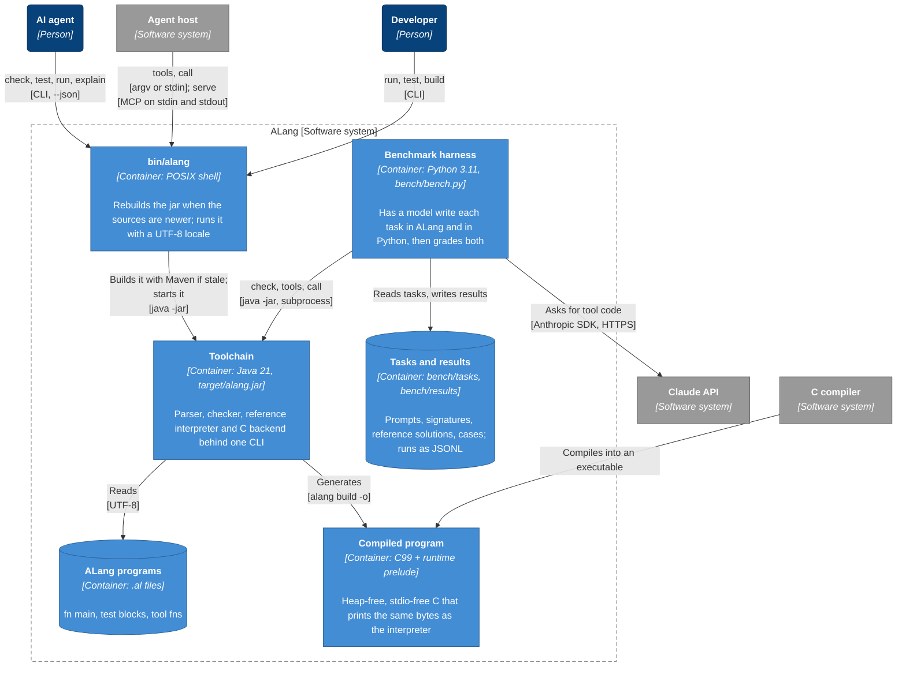
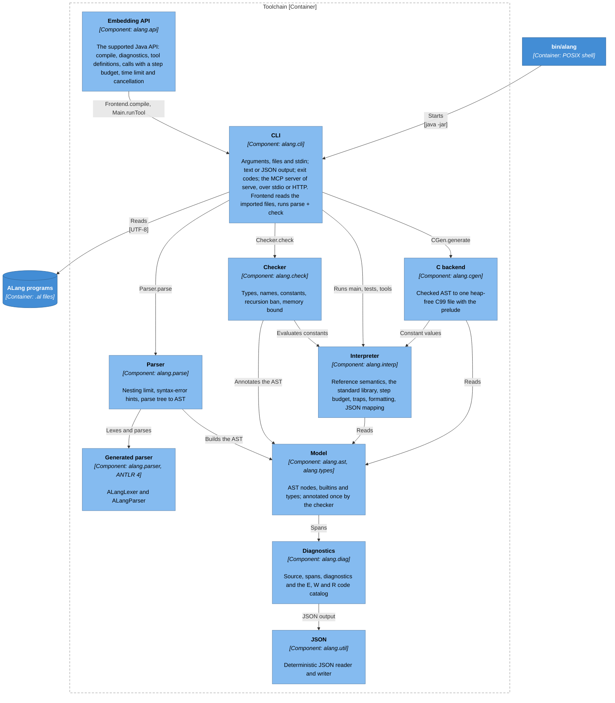
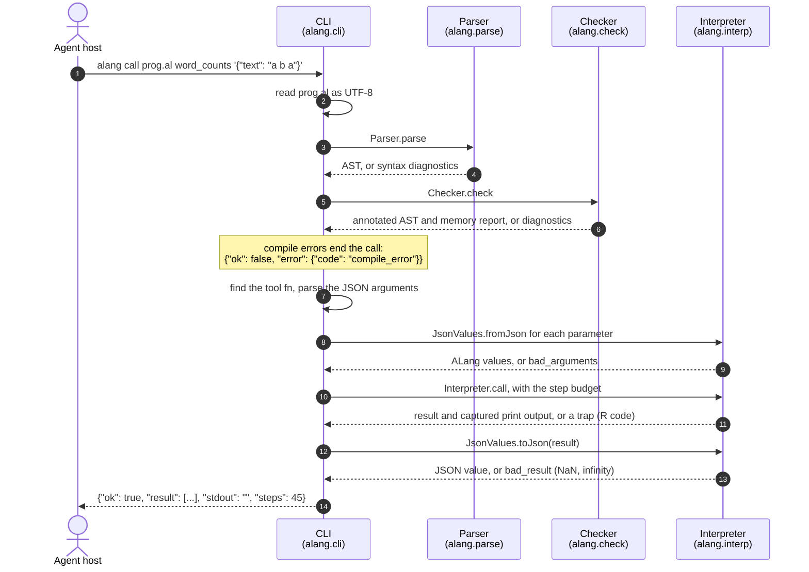

# Architecture

[C4](https://c4model.com) diagrams of ALang as Mermaid flowcharts. `ArchitectureTest` enforces the
component layering; `DocsTest` fails when the `[Component: ...]` boxes and the packages differ.

## Containers

The toolchain never reaches out: no network, processes, clock, environment or randomness. It reads the
source and its imports (and stdin for `call -` and `fn main(input)`), and writes stdout, stderr and
`build -o`. `bin/alang` rebuilds the jar when sources are newer and runs it under `LC_ALL=C.UTF-8`. A
compiled program is one C99 file: the program plus the [prelude](../src/main/resources/alang/cgen/prelude.c),
writing with `write(2)` (`_write` on Windows, `AL_WRITE` freestanding). Only the
[benchmark](../bench/README.md) talks to the Claude API.

## Components of the toolchain

One component per Java package; the parser is generated from [`grammar/ALang.g4`](../grammar/ALang.g4).

Every component reports through Diagnostics and may use JSON. The rules, from
[`ArchitectureTest`](../src/test/java/alang/ArchitectureTest.java):

- **Layers**, bottom-up: JSON, Diagnostics, Model, then Parser, Interpreter, Checker and C backend, then
  the CLI, with the API on top. Only the API uses the CLI, so a host's call runs exactly as `alang call`;
  its public methods use only JDK and `alang.api` types.
- **One value per constant**: the checker evaluates constants with `Interpreter.evalConst`; the C backend
  turns those values into C initializers.
- **ANTLR stays in the parser**; **the AST is written once**, by the parser and the checker.
- **I/O at the edge**: only the CLI and API touch files, only the CLI stdin or `System.exit`. Nothing reads
  a clock, randomness or the environment, reflects, logs or depends on the locale. The exceptions are in
  `serve`: call threads, a `--timeout` watchdog, the `--watch` poller, and `HttpTransport` (clock for logs
  and metrics, random session ids, a shutdown hook). Each call is still one run on one thread, which
  another can only stop through its `Meter`.

## A tool call

`run` and `test` take the same path to the interpreter; `build` hands the checked program to the C backend.

