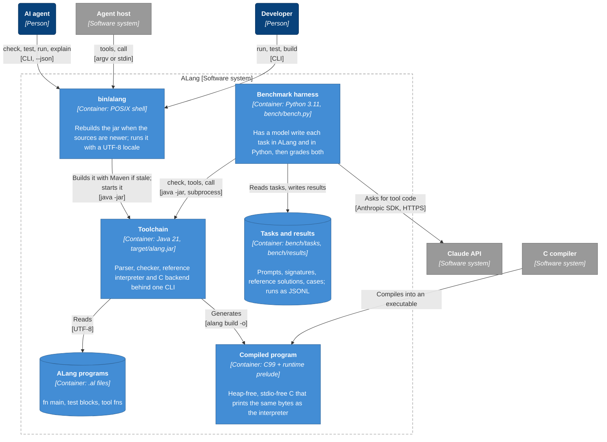
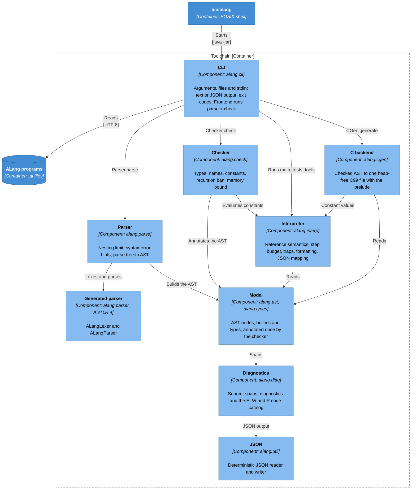

# Architecture

These diagrams describe ALang with the [C4 model](https://c4model.com):

1. [System context](#level-1-system-context): who uses ALang and what it talks to.
2. [Containers](#level-2-containers): the pieces that run or hold data.
3. [Components](#level-3-components-of-the-toolchain): the parts of the toolchain.
4. [Dynamic view](#dynamic-view-a-tool-call): one tool call, step by step.

Level 4, the code, is the source itself.

Every box names its element type, and its technology where there is one, in brackets. Arrows point
from the element that uses to the element used, labeled with what for and, in brackets, how. Dashed
boxes are boundaries. Colors follow the usual C4 key: dark blue for people, lighter blues for ALang
and its parts, grey for systems outside it. The diagrams are [Mermaid](https://mermaid.js.org) flowcharts, which
GitHub renders in place; Mermaid's own C4 diagram types are experimental and lay these diagrams out
with crossing arrows.

The component diagram is checked: `ArchitectureTest` enforces the layering it shows, and `DocsTest`
fails when its `[Component: ...]` boxes and the toolchain's packages differ.

## Level 1: System context

The toolchain never reaches out: it has no network access, starts no processes, and reads no clock,
environment or randomness. It reads the source file it is given (and stdin for `call -`) and writes
stdout, stderr and the `-o` file of `build`. The only network traffic is the benchmark's requests to
the Claude API. The C compiler is the user's: `alang build` writes C99, and `cc` turns it into an
executable.

## Level 2: Containers

| Container | What it is |
|-----------|------------|
| `bin/alang` | The launcher. It runs `mvn package` when `target/alang.jar` is missing or older than `pom.xml`, `grammar/` or `src/main`, and starts the jar under `LC_ALL=C.UTF-8` so command-line arguments decode the same on every host. |
| Toolchain | `target/alang.jar`, a shaded jar with the toolchain and the ANTLR runtime. It implements every `alang` command; its parts are in the component diagram below. |
| ALang programs | `.al` source files: `examples/`, the conformance programs in `tests/`, and whatever an agent writes. |
| Compiled program | The single C99 file `alang build` writes: the program plus the runtime prelude (`src/main/resources/alang/cgen/prelude.c`). It uses no heap and no stdio; output goes to `write(2)`, or to `AL_WRITE` on freestanding targets. |
| Benchmark harness | [`bench/bench.py`](../bench/bench.py) holds one conversation per task and language with a Claude model, grades the programs on hidden cases, and reports silent failures. It runs the jar directly and runs Python solutions in separate processes. See [bench/README.md](../bench/README.md). |
| Tasks and results | `bench/tasks/<name>/` (prompt, signatures, reference solutions, `cases.json`) and the `bench/results/*.jsonl` files that `run` writes. |

## Level 3: Components of the toolchain

One component per Java package; the generated parser is built from
[`grammar/ALang.g4`](../grammar/ALang.g4) on every build.

The diagram leaves out most arrows into the two bottom components: every component reports through
Diagnostics (syntax and type errors, trap codes), and any of them may use JSON. The rules behind the
arrows come from [`ArchitectureTest`](../src/test/java/alang/ArchitectureTest.java):

- **Layers, read bottom-up**: JSON (`alang.util`), Diagnostics (`alang.diag`), the Model
  (`alang.ast` and `alang.types`, which refer to each other), then Parser, Interpreter, Checker and
  C backend, with the CLI on top. A component uses only the layers below it, and nothing uses the CLI.
- **The checker and the C backend share the interpreter's values.** The checker evaluates constants
  with `Interpreter.evalConst`, so a constant has one value everywhere; the C backend turns those
  values (`alang.interp.Values`) into C initializers. The two do not depend on each other.
- **ANTLR stays in the parser.** Only `alang.parse` sees the generated parser or the ANTLR runtime;
  everything after it works on the AST.
- **The AST is written once.** Only the parser and the checker set fields on AST nodes. The
  interpreter, C backend and CLI read the checker's annotations, so one checked program can be run,
  tested and compiled any number of times with the same result.
- **I/O at the edge.** Only the CLI touches files, stdin or `System.exit`; the other components get
  source text and output streams from it. No component reads a clock, randomness or the
  environment, starts threads, uses reflection or logs, and all text is independent of the host
  locale and charset.

## Dynamic view: a tool call

What happens for `alang call prog.al word_counts '{"text": "a b a"}'`, drawn as a sequence. `run`
and `test` take the same path up to the interpreter; `build` hands the checked program to the C
backend instead.

Every step is deterministic: the same program and arguments give the same bytes, the same step
count and the same trap on every run, machine and locale.
