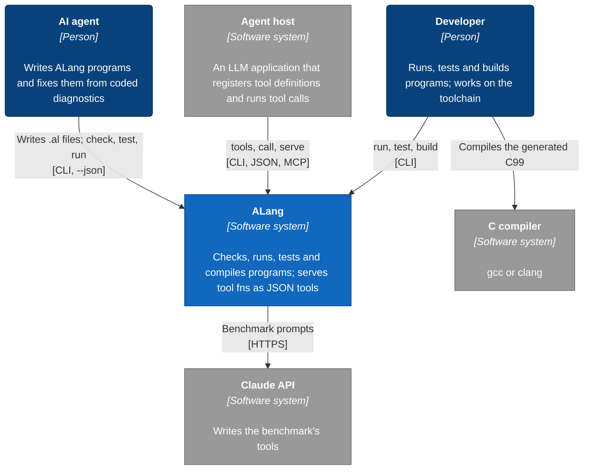
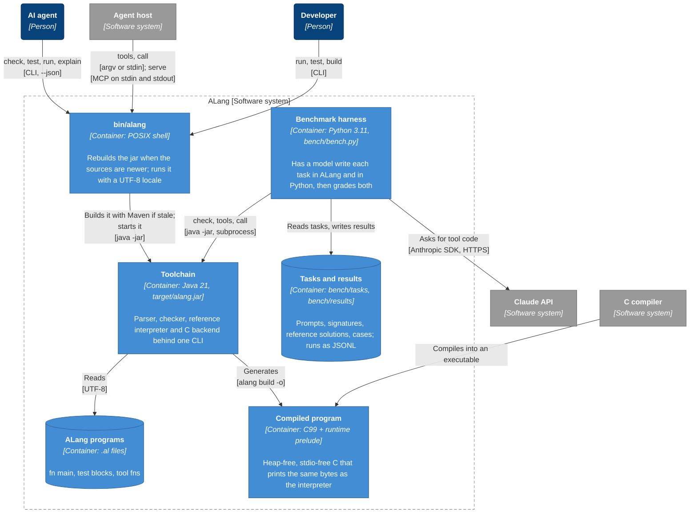
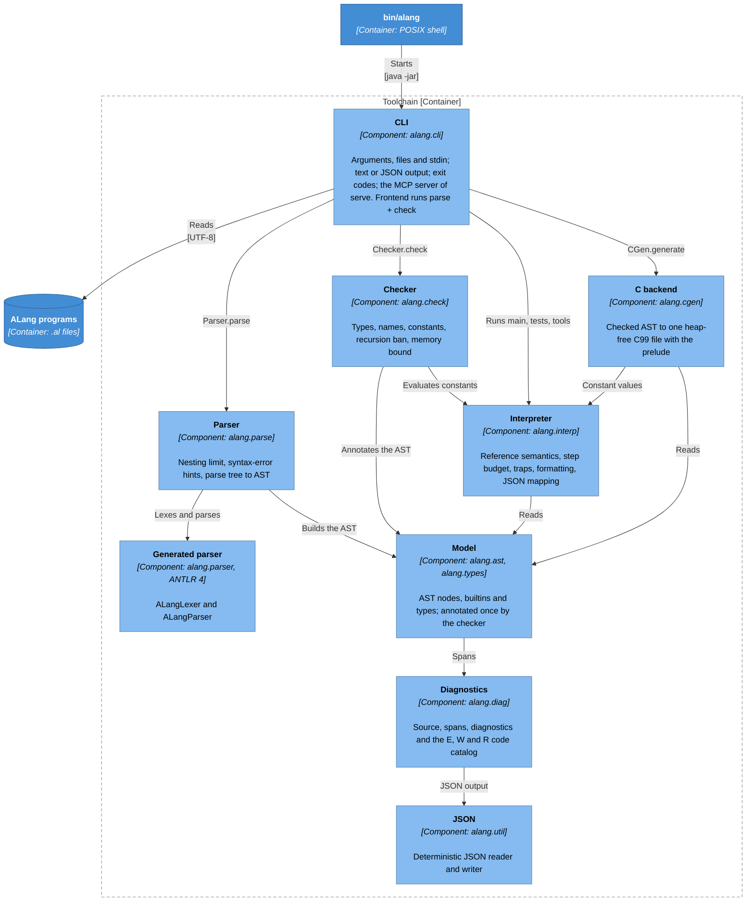
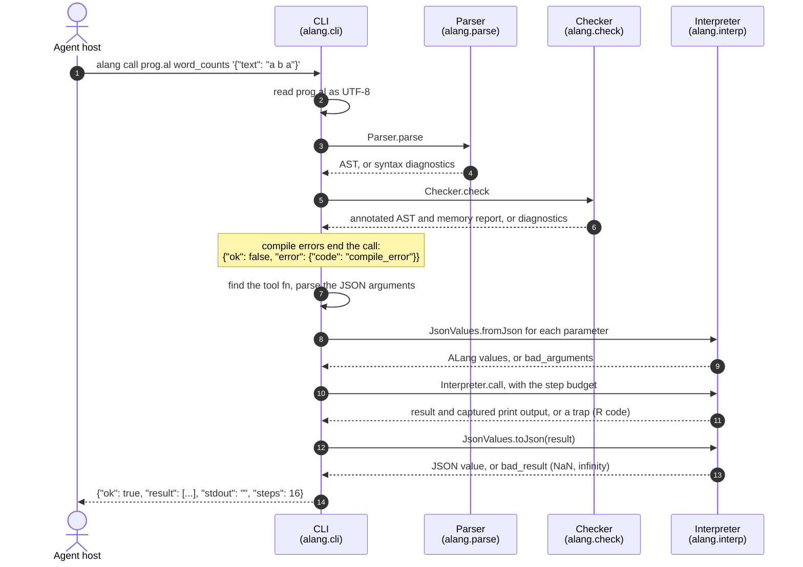

# Architecture

[C4 model](https://c4model.com) diagrams of ALang: the [system context](#level-1-system-context), its
[containers](#level-2-containers), the [toolchain's components](#level-3-components-of-the-toolchain) and
[one tool call](#dynamic-view-a-tool-call); level 4 is the code. Each box names its element type, and
technology, in brackets; arrows point from user to used; colors follow the C4 key. The diagrams are
[Mermaid](https://mermaid.js.org) flowcharts, which GitHub renders (Mermaid's own C4 diagrams are
experimental and cross their arrows). `ArchitectureTest` enforces the component diagram's layering, and
`DocsTest` fails when its `[Component: ...]` boxes and the toolchain's packages differ.

## Level 1: System context

The toolchain never reaches out: no network, processes, clock, environment or randomness. It reads the
source file (and stdin for `call -`) and writes stdout, stderr and the `-o` file of `build`. Only the
benchmark talks to the Claude API, and the C compiler is the user's.

## Level 2: Containers

- `bin/alang` runs `mvn package` when `target/alang.jar` is missing or older than `pom.xml`, `grammar/`
  or `src/main`, and starts the jar under `LC_ALL=C.UTF-8`, so arguments decode the same on every host.
- The jar shades in the ANTLR runtime. A compiled program is one C99 file, the program plus the runtime
  [prelude](../src/main/resources/alang/cgen/prelude.c); it writes with `write(2)`, or `AL_WRITE` on
  freestanding targets.
- The [benchmark](../bench/README.md) runs the jar directly, runs Python solutions in separate
  processes, and writes `bench/results/*.jsonl`.

## Level 3: Components of the toolchain

One component per Java package; the generated parser is built from
[`grammar/ALang.g4`](../grammar/ALang.g4) on every build.

Most arrows into the bottom two components are left out: every component reports through Diagnostics,
and any may use JSON. The rules behind the arrows, from
[`ArchitectureTest`](../src/test/java/alang/ArchitectureTest.java):

- **Layers**, bottom-up: JSON, Diagnostics, the Model (`alang.ast` and `alang.types` refer to each
  other), then Parser, Interpreter, Checker and C backend, with the CLI on top. Nothing uses the CLI.
- **One value per constant**: the checker evaluates constants with `Interpreter.evalConst`, and the C
  backend turns those values into C initializers; the two do not depend on each other.
- **ANTLR stays in the parser**, and **the AST is written once**: only the parser and the checker set its
  fields, so a checked program can be run, tested and compiled any number of times.
- **I/O at the edge**: only the CLI touches files, stdin or `System.exit`. No component reads a clock,
  randomness or the environment, starts threads, reflects or logs, and no text depends on the host
  locale or charset.

## Dynamic view: a tool call

`alang call prog.al word_counts '{"text": "a b a"}'`, step by step. `run` and `test` take the same path
to the interpreter; `build` hands the checked program to the C backend instead.

Every step is deterministic: the same program and arguments give the same bytes, step count and trap on
every run, machine and locale.
